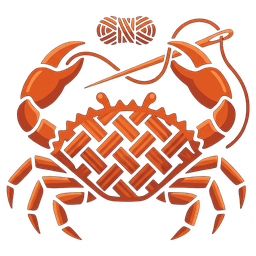

<p align="center">
  
</p>

<h1 align="center">rajutara-skills</h1>

<p align="center"><b>Agent skills for <a href="https://github.com/rajutara/rajutara">rajutara</a>, the open-source apparel CAD for pattern design, grading, marker making and cut planning.</b></p>

<p align="center">
  
  
  
</p>

Seven skills that teach a coding agent (Claude Code, Codex, Cursor, omp and any other agent that reads `SKILL.md` files) how to build, extend, script and operate rajutara, and what it must never do. Each skill is one `skills/<name>/SKILL.md` with `name` and `description` frontmatter, at most 300 lines, written from the rajutara sources: every path and command it cites exists in the rajutara checkout (`scripts/verify.sh` checks that).

## Install

```sh
npx skills add https://github.com/rajutara/rajutara-skills            # pick skills and agents interactively
npx skills add https://github.com/rajutara/rajutara-skills --all      # every skill, every detected agent
npx skills add https://github.com/rajutara/rajutara-skills -s rajutara-operator -g   # one skill, user-level
npx skills add https://github.com/rajutara/rajutara-skills --list     # list without installing
```

[`skills`](https://www.npmjs.com/package/skills) copies or links each skill into the folder its agent reads. Checked with `skills add <this repo> -a claude-code -a codex -a cursor -a opencode --copy`:

| Agent | Reads | Written by `skills add` |
|---|---|---|
| Claude Code | `.claude/skills/<name>/SKILL.md` in the project (with `-g`, the user-level skills folder) | yes |
| Codex, Cursor, opencode and other agents that read the shared folder | `.agents/skills/<name>/SKILL.md` in the project (with `-g`, the user-level equivalent) | yes |
| omp | `.omp/skills/<name>/SKILL.md` in the project or `~/.omp/agent/skills/<name>/SKILL.md` for the user | copy by hand, below |

omp, or any agent the installer does not know, from a clone of this repo:

```sh
mkdir -p ~/.omp/agent/skills && cp -r skills/rajutara-* ~/.omp/agent/skills/
```

The skills describe the rajutara repository, so open the agent in a checkout of `rajutara` (or give it the path). Paths in the skills are relative to that root.

## The skills

| Skill | Use it when | Source in rajutara |
|---|---|---|
| [`rajutara-dev`](skills/rajutara-dev/SKILL.md) | You change code: build and gates, crate map, adding a tool, command, pane, model field or translated string, conventions. | `AGENTS.md`, `CONTRIBUTING.md`, `docs/spec/00-overview.md` §4 and §5 |
| [`rajutara-core-model`](skills/rajutara-core-model/SKILL.md) | You read or build documents: `Style`, `Piece`, `Contour`, `SizeTable`, `GradeRule`, `Marker`, `Order`, `CutPlan`, ids, units, validation. | `docs/spec/01-core-model.md`, `crates/rajutara-core` |
| [`rajutara-io`](skills/rajutara-io/SKILL.md) | You import or export DXF, RUL, HPGL/2, PDF, CSV or native files; `ImportIssue` handling; fixtures. | `docs/spec/02-pds.md` §7 to §9, `crates/rajutara-io` |
| [`rajutara-nesting`](skills/rajutara-nesting/SKILL.md) | You nest a Marker from code, tune it, read its report, or change the engine; `Stop` modes, seeds, the 300-piece gate. | `docs/spec/04-marker.md` §6, `crates/rajutara-nest` |
| [`rajutara-headless`](skills/rajutara-headless/SKILL.md) | You verify a build or automate a job without a screen: `--smoke`, `tshirt_sample`, the end-to-end test, scripting. | `docs/spec/07-ui-shell.md` §1, `crates/rajutara/examples` |
| [`rajutara-operator`](skills/rajutara-operator/SKILL.md) | An assistant helps a workshop Operator: PDS, Grading, Marker and Cut Plan workflows in Optitex vocabulary, shortcuts, importing a graded ASTM file, making a marker, planning a cut order. | `GLOSSARY.md`, `docs/spec/02-pds.md` to `05-cutplan.md` |
| [`rajutara-clean-room`](skills/rajutara-clean-room/SKILL.md) | Before you add a feature, format, asset, fixture or dependency: ADR 0001 (no Optitex files), ADR 0002 (MIT OR Apache-2.0, no GPL), ADR 0013 (RUL is open). | `docs/adr/0001`, `0002`, `0013` |

[`skills/index.json`](skills/index.json) lists them for tools that prefer a manifest.

Start a developer session with `rajutara-clean-room` and `rajutara-dev`; they point to the others. Give an Operator-facing assistant only `rajutara-operator`.

## Verify

```sh
scripts/verify.sh                       # layout: frontmatter, 300-line cap, index.json
scripts/verify.sh /path/to/rajutara     # also: every cited repository path exists in that checkout
```

Run it after changing a skill, and after rajutara moves a file a skill cites.

## Contributing

- One concern per skill, at most 300 lines, concrete: commands, file paths and type names that exist.
- Quote the YAML `description` and say when to use the skill; keep `name` equal to the folder name and add the skill to `skills/index.json`.
- Never cite, quote or describe anything from an Optitex installation, and never copy GPL code or text into a skill (`rajutara-clean-room`).
- When rajutara and a skill disagree, the rajutara code and specs win; fix the skill.

## Licence

Licensed under either of [Apache-2.0](LICENSE-APACHE) or [MIT](LICENSE-MIT) at your option. The logo is project artwork under the same licence.
